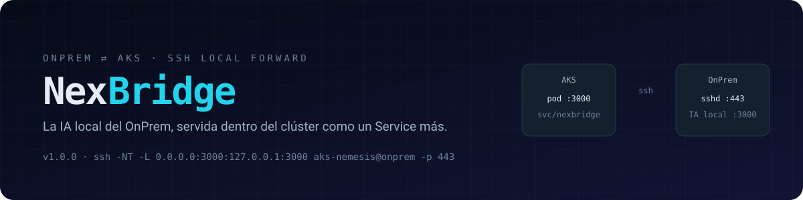
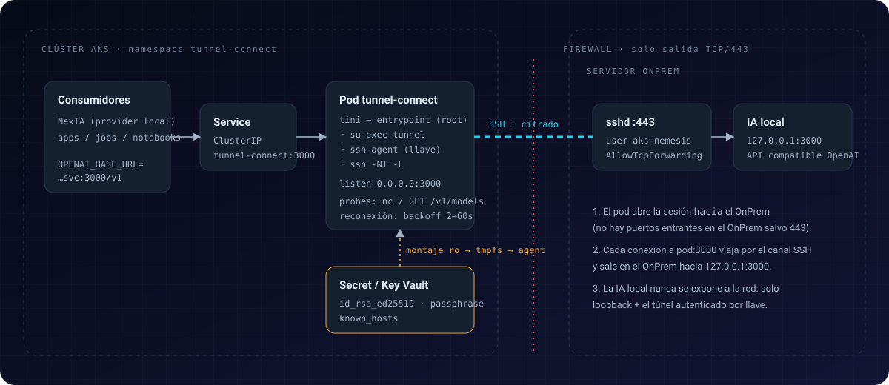

<p align="center">
  
</p>

<p align="center">
  <a href="https://github.com/JGandiaC/NexBridge/releases/latest"></a>
  
  
  
  
</p>

# NexBridge

**NexBridge** publica dentro de un clúster **AKS** servicios que viven en un **servidor OnPrem**,
a través de un túnel SSH saliente, cifrado y autenticado por llave. El servicio OnPrem no se expone a la
red: sigue escuchando sólo en `127.0.0.1` y se consume desde el clúster como un `Service` de Kubernetes.

Caso de uso actual: la **IA local compatible con la API de OpenAI** del OnPrem, consumida desde AKS por
NexIA y otras aplicaciones.

---

## Contenido

- [Arquitectura](#arquitectura)
- [Características](#características)
- [Requisitos](#requisitos)
- [Instalación desde release](#instalación-desde-release)
- [Inicio rápido](#inicio-rápido)
- [Gestión de secretos](#gestión-de-secretos)
- [Despliegue en AKS](#despliegue-en-aks)
- [Consumo del servicio](#consumo-del-servicio)
- [Configuración](#configuración)
- [Configuración del servidor OnPrem](#configuración-del-servidor-onprem)
- [Operación](#operación)
- [Modelo de seguridad](#modelo-de-seguridad)
- [Sandbox SSH](#sandbox-ssh)
- [Estructura del repositorio](#estructura-del-repositorio)
- [Documentación](#documentación)
- [Versionado y flujo de ramas](#versionado-y-flujo-de-ramas)

---

## Arquitectura

<p align="center">
  
</p>

Al arrancar, el contenedor establece el siguiente túnel y lo mantiene abierto:

```bash
ssh -vvv -NT \
  -o ExitOnForwardFailure=yes \
  -o ServerAliveInterval=30 \
  -o ServerAliveCountMax=3 \
  -p 443 \
  -i id_rsa_ed25519 \
  -L 0.0.0.0:3000:127.0.0.1:3000 \
  aks-nemesis@<onprem>
```

| Fase | Qué ocurre |
|---|---|
| **Arranque** | El entrypoint copia llave, passphrase y `known_hosts` desde el Secret a un tmpfs, cede privilegios al usuario `tunnel` y carga la llave en `ssh-agent`. Las copias en disco se eliminan. |
| **Conexión** | `ssh` abre una conexión **saliente** a `OnPrem:443`, verifica la host key y se autentica como `aks-nemesis`. Publica `0.0.0.0:3000` en el pod. |
| **Petición** | Un consumidor llama a `nexbridge:3000`. La conexión viaja por el canal SSH y se entrega en el OnPrem a `127.0.0.1:3000`. |
| **Recuperación** | Si la sesión cae (3 keepalives sin respuesta), el proceso reintenta con backoff exponencial de 2 a 60 s. Mientras tanto la readiness falla y el pod deja de recibir tráfico. |

Diagrama animado paso a paso: [`docs/docs/architecture/tunnel-path.html`](docs/docs/architecture/tunnel-path.html).

## Características

- **Túnel gestionado** — se abre al arrancar el contenedor, con keepalives, `ExitOnForwardFailure`, reconexión automática y apagado ordenado (`tini`, `SIGTERM`).
- **Credenciales protegidas** — llave y passphrase como ficheros montados desde Kubernetes Secret o Azure Key Vault; passphrase entregada por `SSH_ASKPASS` de un solo uso; llave descifrada sólo en memoria.
- **Verificación de host** — `known_hosts` con `StrictHostKeyChecking=yes`.
- **Mínimo privilegio** — `ssh` como usuario sin privilegios, rootfs de sólo lectura, capabilities reducidas, sin token de ServiceAccount.
- **Salud observable** — `healthcheck.sh` para Docker `HEALTHCHECK` y probes de Kubernetes, con comprobación HTTP extremo a extremo.
- **Varios reenvíos** — `TUNNEL_FORWARDS` admite múltiples `-L`.
- **Sandbox SSH** — el servidor SSH de pruebas de versiones anteriores sigue disponible para desarrollo local.

## Requisitos

| Entorno | Requisito |
|---|---|
| Local | Docker 24+ con Compose v2 |
| AKS | Kubernetes 1.28+, `kubectl`, `az`, acceso `AcrPull` al registro |
| Red | Salida TCP/443 desde AKS hacia el OnPrem |
| OnPrem | `sshd` en el puerto 443 con el usuario `aks-nemesis` y la llave pública autorizada |
| Credenciales | Llave privada `id_rsa_ed25519` y su passphrase |

## Instalación desde release

Cada release publica la imagen construida como artefacto, con sus sumas SHA-256:

| Artefacto | Plataforma |
|---|---|
| `nexbridge-<versión>-linux-amd64.tar.gz` | AKS, servidores x86_64 |
| `nexbridge-<versión>-linux-arm64.tar.gz` | Apple Silicon, nodos ARM |
| `SHA256SUMS` | Verificación de integridad |

```bash
VERSION=1.0.0
gh release download v$VERSION --repo JGandiaC/NexBridge \
  --pattern "nexbridge-$VERSION-linux-amd64.tar.gz" --pattern SHA256SUMS
shasum -a 256 --ignore-missing -c SHA256SUMS
docker load -i nexbridge-$VERSION-linux-amd64.tar.gz

docker tag nexbridge:$VERSION <registro>.azurecr.io/nexbridge:$VERSION
docker push <registro>.azurecr.io/nexbridge:$VERSION
```

Guía completa: [Instalación desde release](docs/docs/guides/instalacion.md).

## Inicio rápido

```bash
cp .env.example .env                              # definir TUNNEL_REMOTE_HOST
make secrets-init                                 # llave + passphrase en ./secrets/ (validadas)
make known-hosts TUNNEL_REMOTE_HOST=<ip-onprem>   # fijar la host key del OnPrem
make build run
make logs
make test-tunnel                                  # GET http://localhost:3000/v1/models
```

Salida esperada:

```text
[entrypoint] === NexBridge 1.0.0 ===
[tunnel] llave cargada en ssh-agent (SHA256:…)
[tunnel] abriendo túnel (intento 1)
Authenticated to <ip-onprem> ([<ip-onprem>]:443) using "publickey".
```

`make help` muestra todos los objetivos disponibles.

## Gestión de secretos

El contenedor lee sus credenciales como ficheros en `/run/secrets/tunnel/`:

| Fichero | Contenido | Obligatorio |
|---|---|---|
| `id_rsa_ed25519` | Llave privada OpenSSH cifrada | Sí |
| `passphrase` | Passphrase de la llave, sin salto de línea final | Sí, si la llave está cifrada |
| `known_hosts` | Host key del OnPrem (`[ip]:443 ssh-ed25519 …`) | Recomendado; obligatorio en producción |

| Entorno | Mecanismo |
|---|---|
| Local | Docker secrets a partir de `./secrets/` (`make secrets-init`) |
| AKS | Secret `nexbridge-ssh` creado con `make k8s-secret`, sin YAML con valores |
| Producción | Azure Key Vault + Secrets Store CSI Driver (`k8s/optional/keyvault-secretproviderclass.yaml`) |

> [!IMPORTANT]
> `secrets/`, `.env` y `k8s/secret.yaml` están excluidos del control de versiones. Los Secrets de
> Kubernetes se almacenan en base64: habilita el cifrado en reposo de etcd con KMS o utiliza Key Vault.

Procedimiento de rotación y detalles: [Secretos y passphrase](docs/docs/guides/secretos.md).

## Despliegue en AKS

```bash
make push ACR=<registro>.azurecr.io VERSION=1.0.0
# k8s/configmap.yaml      → TUNNEL_REMOTE_HOST
# k8s/kustomization.yaml  → images[0].newName = <registro>.azurecr.io/nexbridge
make k8s-secret
make k8s-apply
make k8s-status
make k8s-test
```

| Recurso | Descripción |
|---|---|
| `Namespace` | `nexbridge`, Pod Security `baseline` |
| `Deployment` | 1 réplica, `maxUnavailable: 0`, probes de arranque/readiness/liveness, rootfs de sólo lectura, `emptyDir` en memoria |
| `Service` | `ClusterIP` en el puerto 3000 |
| `ConfigMap` | Destino, reenvíos, verbosidad y ruta de salud |
| `ServiceAccount`, `PodDisruptionBudget` | Sin token montado; disrupción controlada |
| `optional/NetworkPolicy` | Ingress sólo desde namespaces consumidores; egress sólo a `OnPrem:443` y DNS |
| `optional/SecretProviderClass` | Credenciales desde Azure Key Vault |

Guía completa: [Despliegue en AKS](docs/docs/guides/despliegue-aks.md).

## Consumo del servicio

Endpoint dentro del clúster:

```text
http://nexbridge.nexbridge.svc.cluster.local:3000/v1
```

```python
from openai import OpenAI

client = OpenAI(
    base_url="http://nexbridge.nexbridge.svc.cluster.local:3000/v1",
    api_key="not-needed",
)
```

Integración con NexIA (proveedor local):

```env
LOCAL_API_URL=http://nexbridge.nexbridge.svc.cluster.local:3000/v1
LOCAL_API_KEY=not-needed
```

El túnel es TCP transparente: las respuestas en streaming (SSE) funcionan sin cambios.

## Configuración

| Variable | Valor por defecto | Descripción |
|---|---|---|
| `TUNNEL_REMOTE_HOST` | — | IP o FQDN del OnPrem (**obligatoria**) |
| `TUNNEL_REMOTE_USER` | `aks-nemesis` | Usuario SSH |
| `TUNNEL_REMOTE_PORT` | `443` | Puerto de `sshd` en el OnPrem |
| `TUNNEL_FORWARDS` | `0.0.0.0:3000:127.0.0.1:3000` | Reenvíos `-L`, separados por espacio |
| `TUNNEL_VERBOSITY` | `3` | Nivel de log de `ssh` (`0`–`3`; `3` equivale a `-vvv`) |
| `TUNNEL_SERVER_ALIVE_INTERVAL` | `30` | `ServerAliveInterval` en segundos |
| `TUNNEL_SERVER_ALIVE_COUNT_MAX` | `3` | `ServerAliveCountMax` |
| `TUNNEL_CONNECT_TIMEOUT` | `15` | `ConnectTimeout` en segundos |
| `TUNNEL_BACKOFF_MIN` / `TUNNEL_BACKOFF_MAX` | `2` / `60` | Límites del backoff de reconexión |
| `TUNNEL_MAX_RETRIES` | ilimitado | Finaliza tras N intentos fallidos |
| `TUNNEL_HEALTH_PATH` | — | Ruta HTTP de la probe profunda (en AKS: `/v1/models`) |
| `TUNNEL_EXTRA_SSH_OPTS` | — | Opciones adicionales para `ssh` |
| `TUNNEL_ENABLED` | `true` | Habilita el túnel |
| `SSHD_ENABLED` | `false` | Habilita el sandbox SSH |

Referencia completa: [Configuración](docs/docs/guides/configuracion.md).

## Configuración del servidor OnPrem

Restringe el usuario del túnel para que sólo pueda abrir el reenvío autorizado:

```text
# /etc/ssh/sshd_config
Port 443

Match User aks-nemesis
    AllowTcpForwarding local
    PermitOpen 127.0.0.1:3000
    AllowAgentForwarding no
    X11Forwarding no
    PermitTTY no
    ForceCommand /bin/false
```

## Operación

```bash
make k8s-logs                                                          # logs del túnel
kubectl -n nexbridge exec deploy/nexbridge -- healthcheck.sh --deep
kubectl -n nexbridge rollout restart deploy/nexbridge        # tras rotar credenciales
```

| Síntoma en logs | Causa probable |
|---|---|
| `no se pudo descifrar la llave` | Passphrase incorrecta o con salto de línea final |
| `Host key verification failed.` | La host key del OnPrem no coincide con `known_hosts` — verificar antes de actualizar |
| `Permission denied (publickey)` | Llave pública no autorizada para `aks-nemesis` |
| `Connection timed out` | Sin ruta de red a `OnPrem:443` |
| `open failed: administratively prohibited` | `PermitOpen` no incluye el destino |
| `connect failed: Connection refused` | Túnel correcto; el servicio OnPrem no escucha en `127.0.0.1:3000` |

Más casos: [Operación y troubleshooting](docs/docs/guides/operacion.md).

## Modelo de seguridad

| Amenaza | Mitigación |
|---|---|
| Exposición del servicio OnPrem | Escucha sólo en loopback; acceso únicamente mediante SSH autenticado por llave |
| Robo de credenciales del contenedor | Llave y passphrase eliminadas del disco tras cargarse en `ssh-agent`; tmpfs en memoria |
| Fuga de la passphrase | Nunca en argumentos ni variables de entorno; askpass de un solo uso |
| Suplantación del OnPrem (MITM) | `known_hosts` con `StrictHostKeyChecking=yes` |
| Escalada dentro del pod | Usuario sin privilegios, rootfs de sólo lectura, capabilities reducidas, sin token de API |
| Abuso del usuario SSH | `PermitOpen` + `ForceCommand` en el OnPrem |
| Acceso lateral en el clúster | `NetworkPolicy` opcional para ingress y egress |
| Imagen manipulada | Artefactos de release con `SHA256SUMS` |

Análisis completo, incluidos los riesgos aceptados: [Modelo de seguridad](docs/docs/architecture/seguridad.md).

## Sandbox SSH

Servidor SSH de pruebas heredado de versiones anteriores, activo en `docker-compose.yml` y desactivado en
la imagen y en AKS.

```bash
make keys    # llaves de prueba en ./keys/
make run
make ssh     # tester@localhost -p 2222
```

> [!WARNING]
> Usa credenciales por defecto (`tester`/`tester123`, `root`/`root123`, configurables con
> `SANDBOX_TESTER_PASSWORD` y `SANDBOX_ROOT_PASSWORD`). Uso exclusivo en local.

## Estructura del repositorio

```text
.
├── Dockerfile               Imagen Alpine 3.19 con OpenSSH 9.6, tini y su-exec
├── entrypoint.sh            Preparación de credenciales y sandbox; cesión de privilegios
├── scripts/
│   ├── tunnel.sh            ssh-agent y bucle de túnel con reconexión
│   ├── askpass.sh           Entrega de passphrase de un solo uso
│   ├── healthcheck.sh       Comprobación de listeners y HTTP extremo a extremo
│   └── secrets-init.sh      Preparación y validación de ./secrets/
├── docker-compose.yml       Entorno local con Docker secrets
├── k8s/                     Manifiestos kustomize para AKS
│   └── optional/            NetworkPolicy y SecretProviderClass
├── docs/                    Documentación mkdocs-material
├── generate-keys.sh         Llaves del sandbox
└── ssh_config               Configuración de cliente del sandbox
```

## Documentación

```bash
make docs-install
make docs-serve    # http://127.0.0.1:8000
```

| Documento | Contenido |
|---|---|
| [Flujo OnPrem → AKS](docs/docs/architecture/flujo.md) | Arquitectura, diagrama de secuencia y recorrido animado |
| [Modelo de seguridad](docs/docs/architecture/seguridad.md) | Límites de confianza, amenazas, riesgos aceptados |
| [Instalación desde release](docs/docs/guides/instalacion.md) | Imagen publicada, verificación y subida a ACR |
| [Secretos y passphrase](docs/docs/guides/secretos.md) | Secret, Key Vault, Docker secrets, rotación |
| [Despliegue en AKS](docs/docs/guides/despliegue-aks.md) | Pasos, probes, seguridad, alta disponibilidad |
| [Consumo de la IA local](docs/docs/guides/consumir-ia.md) | curl, SDK de OpenAI, NexIA |
| [Configuración](docs/docs/guides/configuracion.md) | Referencia de variables |
| [Operación](docs/docs/guides/operacion.md) | Logs, errores frecuentes, depuración |
| [Sandbox SSH](docs/docs/guides/sandbox.md) | Entorno de pruebas y simulación del OnPrem |

## Versionado y flujo de ramas

El proyecto sigue [Semantic Versioning](https://semver.org/lang/es/) y Git Flow:

| Rama | Propósito |
|---|---|
| `main` | Versiones publicadas, etiquetadas como `vX.Y.Z` |
| `develop` | Integración |
| `feature/*` | Desarrollo de funcionalidades, se integran en `develop` |
| `release/*` | Preparación de versión, se integran en `main` y `develop` |

Historial de cambios: [CHANGELOG.md](CHANGELOG.md).
