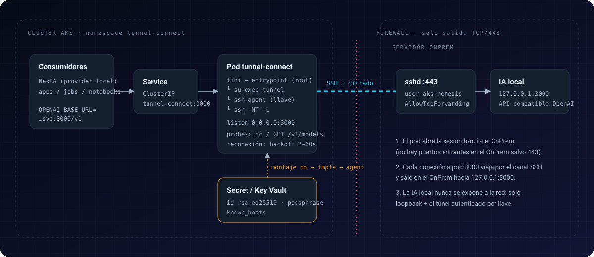
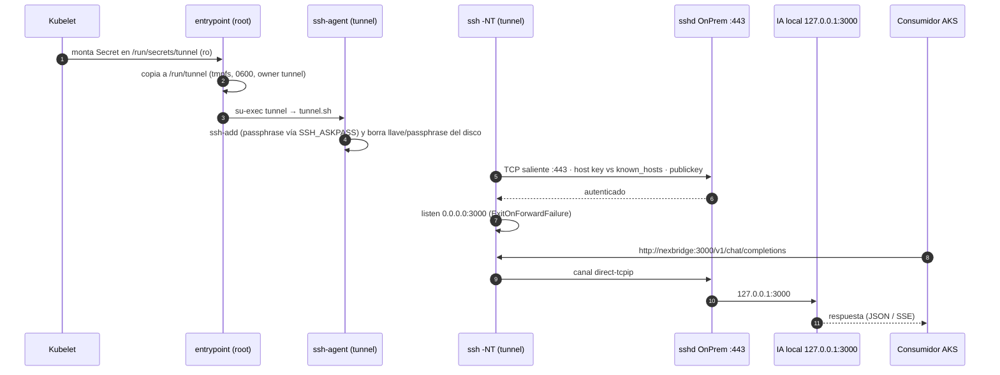

# Flujo OnPrem → AKS

NexBridge resuelve un problema concreto: **servicios que viven en un servidor OnPrem y que deben
consumirse desde AKS** sin abrir puertos entrantes ni exponerlos a la red. Hoy, el servicio es la
**IA local compatible con OpenAI** del OnPrem.



## Recorrido animado

Elige un recorrido — arranque, petición o caída y reconexión — y síguelo paso a paso.

<iframe
  src="../tunnel-path.html"
  title="Diagrama animado del túnel OnPrem → AKS"
  loading="lazy"
  style="width: 100%; height: 980px; border: 1px solid rgba(128,128,128,.3); border-radius: 4px;">
</iframe>

!!! tip "Standalone"
    El diagrama es un HTML autocontenido, sin dependencias. Ábrelo directamente en
    [`docs/architecture/tunnel-path.html`](tunnel-path.html) para verlo a pantalla completa.

## Secuencia



## Las tres piezas

| Pieza | Dónde | Papel |
|---|---|---|
| **Pod `nexbridge`** | AKS, ns `nexbridge` | Inicia la sesión SSH, escucha en `:3000`, se reconecta |
| **`sshd` OnPrem** | Servidor OnPrem, puerto **443** | Autentica a `aks-nemesis` por llave y permite `direct-tcpip` a `127.0.0.1:3000` |
| **IA local** | Servidor OnPrem, `127.0.0.1:3000` | API compatible OpenAI (`/v1/models`, `/v1/chat/completions`, `/v1/embeddings`) |

## Cosas que el diagrama deja claras

- **El OnPrem nunca recibe conexiones a la IA desde fuera.** Sólo el 443 está abierto, y sólo para SSH con llave.
- **El sentido de la conexión es AKS → OnPrem.** El OnPrem sólo necesita aceptar TCP/443 entrante (idealmente restringido a las IPs de salida de AKS); AKS sólo necesita *egress* a `OnPrem:443`.
- **La passphrase se usa una vez.** Tras `ssh-add` se borran la llave en claro y la passphrase de `/run/tunnel`; las reconexiones usan el agente.
- **Un pod NotReady no recibe tráfico.** La readiness hace `GET /v1/models` a través del túnel: si la IA local cae, el Service deja de enrutar a ese pod.
- **Varias réplicas = varias sesiones SSH.** Cada pod abre la suya; el Service reparte. Ver [Despliegue](../guides/despliegue-aks.md#alta-disponibilidad).

## Requisitos en el OnPrem

```text
# /etc/ssh/sshd_config (fragmento)
Port 443

Match User aks-nemesis
    AllowTcpForwarding local
    PermitOpen 127.0.0.1:3000
    X11Forwarding no
    AllowAgentForwarding no
    PermitTTY no
    ForceCommand /bin/false
```

Con `PermitOpen` y `ForceCommand` el usuario `aks-nemesis` **sólo** puede abrir el reenvío a la IA
local: no obtiene shell ni puede alcanzar otros puertos.

!!! note "Sobre `-N`"
    `ForceCommand /bin/false` es compatible con `ssh -N`: no se ejecuta comando remoto, sólo se usan
    los canales de reenvío.
