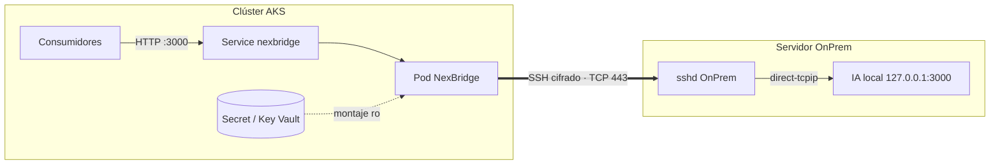

# Modelo de seguridad

NexBridge transporta prompts y respuestas de la IA del OnPrem y custodia la llave que abre el acceso al
servidor. Estos son sus límites de confianza y cómo se protege cada uno.

## Límites de confianza

| Límite | Qué lo cruza | Protección |
|---|---|---|
| Consumidor → Pod | HTTP en claro dentro del clúster | NetworkPolicy: sólo namespaces etiquetados `nexbridge/consumer=true` |
| Pod → OnPrem | Canal SSH | Cifrado SSH, host key fijada, autenticación por llave |
| OnPrem sshd → IA local | Loopback | `PermitOpen 127.0.0.1:3000`; la IA no escucha en red |
| Secret → Pod | Llave y passphrase | Montaje de sólo lectura, tmpfs en memoria, borrado tras cargarse |

## Amenazas y mitigaciones

| Amenaza | Mitigación |
|---|---|
| Exposición del servicio OnPrem a la red | Escucha sólo en loopback; acceso únicamente mediante SSH autenticado por llave |
| Robo de la llave desde el contenedor | La llave y la passphrase se borran del disco tras `ssh-add`; sólo existen en la memoria de `ssh-agent` |
| Fuga de la passphrase | Nunca en argumentos ni en variables de entorno; askpass de un solo uso leído desde fichero |
| Suplantación del OnPrem (MITM) | `known_hosts` con `StrictHostKeyChecking=yes` |
| Escalada dentro del pod | `ssh` como uid 10001, rootfs de sólo lectura, `allowPrivilegeEscalation: false`, capabilities mínimas |
| Abuso de la API de Kubernetes | `automountServiceAccountToken: false` |
| Abuso del usuario SSH en el OnPrem | `ForceCommand /bin/false`, `PermitTTY no`, `PermitOpen` restringido |
| Movimiento lateral en el clúster | NetworkPolicy de ingress y egress (sólo `OnPrem:443` y DNS) |
| Secretos en el repositorio | `secrets/`, `.env` y `k8s/secret.yaml` en `.gitignore`; `make k8s-secret` no escribe YAML |
| Imagen manipulada | Releases con `SHA256SUMS`; verificar antes de `docker load` |

## Riesgos aceptados

- **Tráfico en claro dentro del clúster.** Entre el consumidor y el pod viaja HTTP. Si los prompts son
  sensibles, añade un service mesh con mTLS (Istio, Linkerd) o restringe la NetworkPolicy a consumidores concretos.
- **Secrets de Kubernetes en base64.** Sin cifrado de etcd con KMS, cualquiera con `get secrets` en el
  namespace obtiene la llave y la passphrase. En producción, usa Azure Key Vault.
- **Entrypoint como root.** Necesario para copiar los secretos con el dueño correcto y bajar privilegios;
  el proceso que permanece (`ssh`) no es root.
- **Sandbox SSH.** Credenciales por defecto y login de root. Desactivado en la imagen y en AKS; no habilitarlo fuera de local.

## Recomendaciones para producción

1. Credenciales en **Azure Key Vault** con Workload Identity.
2. `known_hosts` **siempre** presente y verificado con el equipo OnPrem.
3. **NetworkPolicy** aplicada, con el CIDR exacto del OnPrem.
4. En el OnPrem, aceptar el 443 **sólo** desde las IPs de salida de AKS.
5. Rotar la llave periódicamente (ver [Secretos](../guides/secretos.md#rotacion)).
6. `TUNNEL_VERBOSITY=1` una vez estable: `-vvv` no imprime secretos, pero genera mucho volumen de logs.
