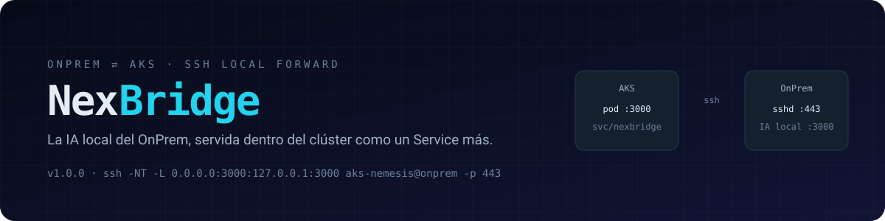

# nexbridge



**nexbridge** es un contenedor que conecta un **servidor OnPrem** con un **clúster AKS** mediante un
túnel SSH *local-forward*. Al arrancar el pod, abre automáticamente:

```bash
ssh -vvv -NT \
  -o ExitOnForwardFailure=yes \
  -o ServerAliveInterval=30 \
  -o ServerAliveCountMax=3 \
  -p 443 \
  -i id_rsa_ed25519 \
  -L 0.0.0.0:3000:127.0.0.1:3000 \
  aks-nemesis@<onprem>
```

y publica dentro del clúster, como un `Service` normal, un servicio que en el OnPrem **sólo escucha en
loopback**. El caso de uso actual: la **IA local compatible con la API de OpenAI** que corre en el OnPrem
(`127.0.0.1:3000`), consumida desde AKS por NexIA y otras aplicaciones.

## Por qué así

| Necesidad | Cómo se resuelve |
|---|---|
| El OnPrem no acepta conexiones entrantes salvo 443 | El pod inicia la sesión **saliente** a `:443` |
| La IA local no debe exponerse a la red | Escucha en `127.0.0.1`; sólo se alcanza por el túnel autenticado |
| La llave SSH está protegida con passphrase | Llave + passphrase en un **Secret** / **Azure Key Vault**, descifrada en `ssh-agent`, nunca en disco |
| Cortes de red, reinicios del OnPrem | Reconexión con backoff exponencial + probes de Kubernetes |
| Los consumidores no deben saber de SSH | `http://nexbridge.nexbridge.svc.cluster.local:3000/v1` |

## Qué incluye

- **Túnel gestionado**: `tunnel.sh` mantiene el `ssh -NT -L` vivo, con keepalives, `ExitOnForwardFailure`, reconexión y apagado limpio (`tini` + `SIGTERM`).
- **Secretos bien tratados**: passphrase por `SSH_ASKPASS` de un solo uso, llave en memoria, host key fijada con `known_hosts`.
- **Mínimo privilegio**: `ssh` corre como usuario `tunnel` (uid 10001), rootfs de sólo lectura, capabilities recortadas.
- **Kubernetes listo**: Deployment, Service, PDB, ServiceAccount, probes, NetworkPolicy y `SecretProviderClass` (Key Vault) opcionales.
- **Sandbox SSH heredado**: el sshd de pruebas de la 0.1.x sigue disponible con `SSHD_ENABLED=true`.

## Enlaces

- [Primeros pasos](getting-started.md)
- [Flujo OnPrem → AKS](architecture/flujo.md) — con diagrama animado
- [Secretos y passphrase](guides/secretos.md)
- [Despliegue en AKS](guides/despliegue-aks.md)
- [Consumir la IA local](guides/consumir-ia.md)
